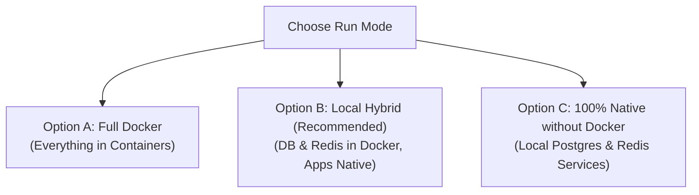

# 🇧🇩 BrandKotha — Creator & Brand Freelancing Marketplace

[](https://turbo.build/)
[](https://fastapi.tiangolo.com/)
[](https://www.postgresql.org/)
[](https://nextjs.org/)
[](https://pnpm.io/)

A dedicated, mobile-first two-sided freelancing and PR collaboration marketplace built specifically for content creators (10K–150K followers) and brands across Bangladesh. Features transparent BDT (৳) pricing, 100-point deterministic match scoring, real-time WebSocket chat, verified mutual reviews, and a feature-flagged monetization engine.

---

## 📌 Current Project Status

> **Note for Developers & Teammates:**  
> The project is currently at the **Architectural Scaffolding & Database Baseline** stage:
> * **Backend:** PostgreSQL 16 database models (8 tables) and Alembic migration `001_initial_schema` are active and applied. The core configuration, Argon2id security helpers, and the 50/25/25 Matching Engine are implemented and unit-tested. The API currently exposes `/` and `/api/v1/health` checks.
> * **Frontend:** The Next.js 15 mobile-first web app is structured with App Router layouts and routes (`/`, `/campaigns`, `/creators`, `/login`, `/register`, `/admin`). **The data currently rendered on the web pages is static mockup data** used to validate mobile-first UX and layouts.
> * **Next Sprint:** Implementing domain REST endpoints (`/api/v1/auth`, `/api/v1/campaigns`, `/api/v1/creators`, `/api/v1/pitches`) and replacing frontend static mockups with live TanStack Query API calls.

---

## 👥 Engineering Team (Team A)

| Name | Role / Focus Area |
| :--- | :--- |
| **Kalpona Koly** | Frontend Architecture, UI/UX & Responsive Components |
| **Mahir Tajuar Akash** | Database Design, Schema Migrations & Data Integrity |
| **Rawfun Shovon** | Real-time Messaging, WebSockets & Background Workers |
| **Sarwar Jahin** | Backend Core, Security Architecture & DevOps CI/CD |

---

## 🏗️ Monorepo Architecture

```text
brand-kotha/
├── apps/
│   ├── api/                 # Python 3.12+ FastAPI Modular Monolith
│   └── web/                 # Next.js 15 (App Router, Tailwind CSS, Zustand)
├── packages/
│   └── api-client/          # Auto-generated TypeScript API SDK (@brandkotha/api-client)
├── docker/                  # Docker Compose (PostgreSQL 16, Redis 7, Dev Containers)
├── docs/                    # Official PRD, TRD v2.0, ER Diagrams & Architecture Records
│   ├── BrandKotha_PRD_and_TRD_v2.md
│   ├── ARCHITECTURE.md
│   └── BrandKotha_PRD_and_TRD_v2.pdf
├── scripts/                 # Bootstrap & Client Generation Scripts
│   ├── setup.sh
│   └── generate-client.sh
├── Makefile                 # 1-command developer automation
├── turbo.json               # Monorepo build pipeline & dependency graph
└── pnpm-workspace.yaml      # pnpm workspace definition
```

---

## ⚡ Prerequisites

Before running the project, ensure you have:

* **Node.js 20+** and **pnpm 9+** (Globally installed):
  ```bash
  node -v   # Should be >= 20.0.0
  npm install -g pnpm
  pnpm -v   # Verified: 12.x
  ```
* **Python 3.12+** (For local backend development):
  ```bash
  python3 --version   # Should be >= 3.12.0
  ```
* **Docker & Docker Compose** *(Optional — only needed if using Docker options)*:
  * [Install Docker Desktop](https://docs.docker.com/get-docker/)

---

## 🚀 Running the Project (Choose Option A, B, or C)

You can run BrandKotha in three different ways depending on your preferred workflow:



---

### Option A: Complete Docker Setup (Easiest — Everything in Docker)

Run this if you don't want to install Python packages locally or manage databases:

```bash
# 1. Copy environment variables
cp .env.example .env

# 2. Build and launch all containers (Postgres 16, Redis 7, FastAPI, Next.js)
make docker-up
```

* **Frontend Web App:** [http://localhost:3000](http://localhost:3000)
* **Backend API Docs:** [http://localhost:8000/docs](http://localhost:8000/docs)
* **Admin Dashboard:** [http://localhost:3000/admin](http://localhost:3000/admin)
* **Stop containers:** `make docker-down`

---

### Option B: Local Hybrid Setup (Recommended — Fastest Hot-Reload DX)

Run this to have PostgreSQL 16 and Redis 7 managed effortlessly by Docker, while running the FastAPI backend and Next.js frontend directly on your host machine for instantaneous hot-reloading:

```bash
# 1. Setup environment & install packages
cp .env.example .env
pnpm install

# 2. Setup Python virtual environment & install dependencies
python3 -m venv apps/api/.venv
source apps/api/.venv/bin/activate
pip install -r apps/api/requirements.txt
deactivate

# 3. Start PostgreSQL 16 & Redis 7 in Docker
docker compose -f docker/docker-compose.yml up -d postgres redis

# 4. Apply database migrations to PostgreSQL
cd apps/api && .venv/bin/alembic upgrade head && cd ../..

# 5. Run the apps locally
# Terminal 1 (Backend API):
make api-dev

# Terminal 2 (Frontend Web):
make web-dev
```

---

### Option C: 100% Native Setup (Completely WITHOUT Docker)

If you do not have Docker installed, you can run everything natively using local system services:

#### 1. Install & Start PostgreSQL 16 & Redis on Your OS:
* **Ubuntu / Debian:**
  ```bash
  sudo apt update
  sudo apt install -y postgresql postgresql-contrib redis-server
  sudo systemctl start postgresql redis-server
  ```
* **macOS (Homebrew):**
  ```bash
  brew install postgresql@16 redis
  brew services start postgresql@16
  brew services start redis
  ```

#### 2. Create the Database & User:
Access the PostgreSQL shell (`sudo -u postgres psql`):
```sql
CREATE USER brandkotha_user WITH PASSWORD 'brandkotha_secret_password';
CREATE DATABASE brandkotha_db OWNER brandkotha_user;
\c brandkotha_db
CREATE EXTENSION IF NOT EXISTS "uuid-ossp";
CREATE EXTENSION IF NOT EXISTS "pg_trgm";
GRANT ALL PRIVILEGES ON DATABASE brandkotha_db TO brandkotha_user;
\q
```

#### 3. Setup Python Backend Environment:
```bash
# Create and activate virtual environment
python3 -m venv apps/api/.venv
source apps/api/.venv/bin/activate
pip install -r apps/api/requirements.txt

# Run initial Alembic migrations against local Postgres
cd apps/api
alembic upgrade head
cd ../..
```

#### 4. Setup Frontend Workspace:
```bash
pnpm install
```

#### 5. Launch the Applications:
* **Start FastAPI Backend (Terminal 1):**
  ```bash
  make api-dev
  # Or: cd apps/api && .venv/bin/uvicorn app.main:app --reload --port 8000
  ```
* **Start Next.js Frontend (Terminal 2):**
  ```bash
  make web-dev
  # Or: pnpm --filter @brandkotha/web dev
  ```

---

## 🛠️ Developer Command Reference (`make`)

| Command | Action |
| :--- | :--- |
| `make dev` | Start DB & Redis in Docker + run FastAPI & Next.js locally |
| `make docker-up` | Run complete stack (DB, Redis, API, Web) inside Docker |
| `make docker-down` | Stop and remove running Docker containers |
| `make docker-logs` | Follow real-time logs from Docker services |
| `make api-dev` | Start only the FastAPI backend standalone (`http://localhost:8000`) |
| `make web-dev` | Start only the Next.js frontend standalone (`http://localhost:3000`) |
| `make test` | Run backend Pytest unit tests and frontend typechecks |
| `make lint` | Run Ruff (Python linter/formatter) and ESLint (Next.js) |
| `make db-migrate` | Apply latest Alembic database migrations |
| `make db-makemigrations` | Auto-generate a new Alembic migration based on model changes |
| `make codegen` | Export FastAPI `/openapi.json` and regenerate TypeScript API client |
| `make clean` | Remove temporary cache files, build outputs, and `.pyc` files |

---

## 🔑 Key Architectural Concepts

### 1. Deterministic 100-Point Match Score
Located in [`apps/api/app/modules/matching/engine.py`](file:///home/sarwar/projects/brand-kotha/apps/api/app/modules/matching/engine.py):
* **Niche Alignment (50 Points):** $+50$ if creator niche matches campaign category; $0$ otherwise.
* **Platform Alignment (25 Points):** $+25$ if creator platform matches campaign platform; $0$ otherwise.
* **Budget & Rate Fit (25 Points):** $+25$ if creator rate $\le$ campaign budget; $+12$ if within $20\%$ negotiable threshold; $0$ otherwise.

### 2. Built-in Monetization Switch (`charge_enabled`)
* Located in [`.env`](file:///home/sarwar/projects/brand-kotha/.env) and database singleton `platform_settings`:
  * `CHARGE_ENABLED=False` $\rightarrow$ Platform runs 100% free during trial cohorts to build search liquidity in Dhaka & Chattogram.
  * `CHARGE_ENABLED=True` $\rightarrow$ Activates paywall for creator/brand monthly subscriptions, profile/campaign boosts, and transaction commissions via bKash, SSLCommerz, and aamarPay.

### 3. Dedicated Admin Panel
* Located inside the web app at [`/admin`](http://localhost:3000/admin).
* Protected by layout guards and FastAPI role checks (`Depends(require_role(UserRole.ADMIN))`).
* Allows platform operators to inspect payments, review audit logs, and toggle platform settings without direct database access.

---

## 📚 Project Documentation

* 📖 **[Comprehensive PRD & TRD v2.0](docs/BrandKotha_PRD_and_TRD_v2.md)**: Full requirements, personas, workflows, database schema dictionary, and launch criteria.
* 🏛️ **[Architecture & ADR Guide](docs/ARCHITECTURE.md)**: Layer boundaries, WebSocket real-time messaging, and design decisions.

---

## 🤝 Contribution Guidelines

1. **Branch Naming:**
   * Feature: `feat/short-description` (e.g., `feat/pitch-workflow`)
   * Bugfix: `fix/short-description` (e.g., `fix/chat-unread-badge`)
2. **Pre-commit Checklist:**
   ```bash
   make lint    # Ensure zero linter errors
   make test    # Ensure all unit tests pass
   ```
3. Open a Pull Request targeting `main`.
