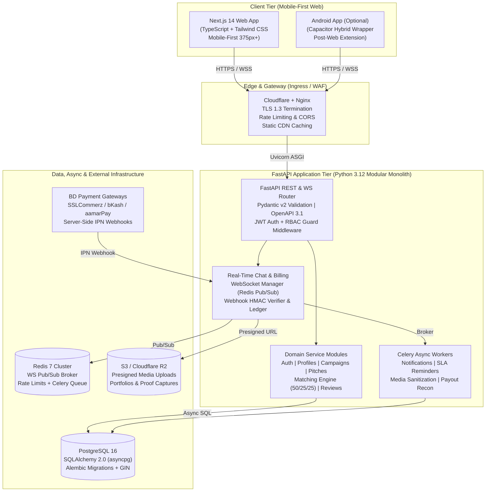
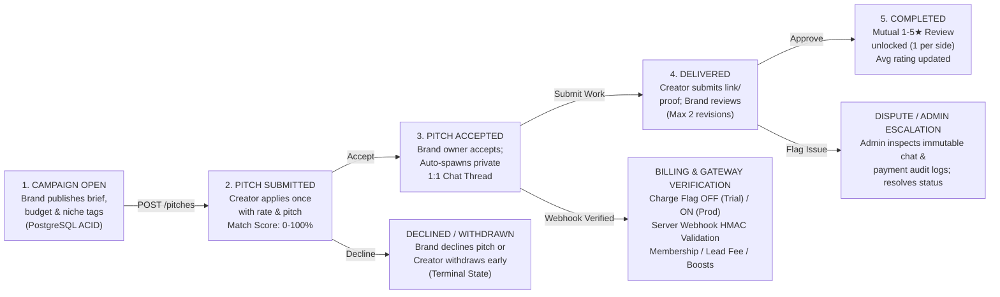

# OFFICIAL SOFTWARE ENGINEERING & ACADEMIC SPECIFICATION

# BrandKotha — Creator & Brand Freelancing Marketplace
## Comprehensive Product Requirements Document (PRD) & Technical Requirements Document (TRD)

> **Architectural Mandate:** Clean, production-hardened, mobile-first two-sided marketplace connecting content creators and brands across Bangladesh. Engineered with a high-concurrency Python 3.12 + FastAPI backend, PostgreSQL 16 relational storage, Redis 7 real-time WebSocket messaging, and a mobile-first Next.js 14 (TypeScript + Tailwind CSS) web frontend (with optional Capacitor Android packaging for future expansion).

---

### Submitted By — Team A

| Team Name | Team Members |
| :--- | :--- |
| **Team A** | **Kalpona Koly**<br/>**Mahir Tajuar Akash**<br/>**Rawfun Shovon**<br/>**Sarwar Jahin** |

### Document Control & Baseline Metadata

| Attribute | Specification Details |
| :--- | :--- |
| **Product Name & Domain** | BrandKotha (Planned Production Domain: `brandkotha.com`) |
| **Document Version & Status** | **Version 2.0** — Production Engineering Baseline (Upgraded from v1.0 Prototype Baseline by Mariam Hasan Raisha) |
| **Date of Publication** | 26 October 2026 |
| **Template Standard** | Aligned with the Brand–Creator Freelancing Marketplace PRD & TRD Documentation Checklist (Part 1: PRD & Part 2: TRD) |
| **Current State vs. Target** | Transitioning from single-page HTML/JS prototype (hosted on claude.ai + local browser demo) to a dedicated FastAPI + PostgreSQL + Next.js production platform. |

*Prepared by Team A (Kalpona Koly, Mahir Tajuar Akash, Rawfun Shovon, Sarwar Jahin) · Chattogram / Dhaka, Bangladesh · Strict Zero-Overcommitment Engineering Standard.*

---

# PART 1: PRODUCT REQUIREMENTS DOCUMENT (PRD)
> Defines product vision, target personas, functional modules, business rules, monetization switch, and MVP acceptance criteria.

---

## 1. Document Information

BrandKotha is a dedicated, mobile-first two-sided freelancing and PR collaboration marketplace built specifically for content creators (influencers and UGC creators) and brands in Bangladesh. Unlike generalist freelance portals such as Upwork or Fiverr that cater to software development or graphic design, BrandKotha streamlines local promotional campaigns, PR package collaborations, sponsored reels/videos, and creator discovery with transparent Bangladeshi Taka (৳) pricing and deterministic match scoring.

| Attribute | Specification Details |
| :--- | :--- |
| **Product Name** | BrandKotha (`brandkotha.com`) — Mobile-First Web Application (with optional Capacitor Android App wrapper). |
| **Engineering Team** | **Team A:** Kalpona Koly, Mahir Tajuar Akash, Rawfun Shovon, Sarwar Jahin. |
| **Version History** | • **v1.0 (26 Oct 2026):** Initial prototype & baseline PRD/TRD by Mariam Hasan Raisha.<br/>• **v2.0 (26 Oct 2026):** Full academic & production FastAPI/Python engineering specification by Team A. |
| **Approval Process** | Requires unanimous review and sign-off by all members of Team A (Kalpona Koly, Mahir Tajuar Akash, Rawfun Shovon, Sarwar Jahin) prior to sprint freeze. |
| **Related References** | 1. `BrandKotha – PRD and TRD.pdf` (v1.0 Prototype Specification).<br/>2. Brand–Creator Freelancing Marketplace PRD & TRD Documentation Checklist (Official Template). |

---

## 2. Product Overview

### 2.1 Product Vision, Mission, and Problem Statement

* **Vision:** Become the most trusted, frictionless digital marketplace in Bangladesh for brands and content creators to discover each other, agree on transparent promotional terms, communicate privately, and build verifiable reputation records.
* **Problem Statement:** Small and medium enterprises (SMEs) and local brands in Bangladesh struggle to discover reliable micro and mid-tier creators for PR and promotional campaigns without paying expensive marketing agency retainers. Simultaneously, creators with 10K–150K followers struggle to secure consistent, paid brand deals. Currently, discovery and negotiation occur informally across fragmented Facebook groups, unorganized Instagram DMs, and personal contacts. This informal workflow results in slow matching, opaque rate negotiation, zero standardized record of campaign deliverables, and rampant fake transaction claims.
* **Proposed Solution & Unique Value Proposition:** BrandKotha replaces fragmented social DMs with a structured, mobile-first marketplace featuring standardized creator portfolios, categorized brand campaigns, a transparent 100-point deterministic compatibility algorithm (50% Niche + 25% Platform + 25% Budget/Rate fit), private real-time chat unlocked upon pitch acceptance, mutual 1-to-5 star verified reviews, and a feature-flagged Bangladeshi monetization engine.

### 2.2 Target Market, Business Model & Competitive Differentiation

| Dimension | Informal Channels (FB Groups / IG DMs) & Global Portals (Upwork) | BrandKotha Production Platform (Team A Architecture) |
| :--- | :--- | :--- |
| **Discovery & Matching** | Manual scrolling in Facebook groups; generic global skill tags on Upwork unsuited for BD influencer niches. | Instant filtering by niche, platform, follower count, and BDT rate, ranked by a deterministic 0–100% Match Score. |
| **Pricing & Currency** | Hidden rates requiring repetitive DM inquiries; Upwork requires USD dual-currency cards. | Upfront BDT (৳) creator base rates and campaign budgets; native bKash, SSLCommerz, and aamarPay support. |
| **Trust & Accountability** | Zero verified collaboration history; anyone can claim past brand work without validation. | Mutual 1–5 star ratings strictly gated behind an accepted pitch collaboration (1 review per side per deal). |
| **Monetization Flexibility** | High upfront platform friction or rigid global escrow fees that deter early local adopters. | Built-in server-side `charge_enabled` switch: runs 100% free during closed/open trials, switches on seamlessly post-validation. |

---

## 3. Goals and Success Metrics

To prevent over-commitment during initial launch, quantitative targets are structured into two phases: baseline instrumentation during the initial 5–10 user closed trial, followed by production KPI thresholds calibrated after 30 days of trial telemetry.

* **North Star Metric:** Number of Accepted & Reviewed Brand–Creator Collaborations completed per month.
* **Brand Success Objective:** Enable an SME brand owner to sign up, publish a structured campaign brief, and identify a ≥75% match-score creator within under 5 minutes.
* **Creator Success Objective:** Enable micro/mid-tier creators to showcase verified social metrics, filter matching campaigns, and submit a tailored pitch in under 2 minutes.

| KPI Category | Telemetry Metric Definition | Trial Baseline & Initial Target |
| :--- | :--- | :--- |
| **Onboarding Activation** | Percentage of registered users who complete all mandatory profile fields (niche, platform, followers, rate/budget). | ≥ 80% profile completion within 24 hours of registration. |
| **Marketplace Liquidity** | Active campaigns posted by brands and average creator pitches received per published campaign. | ≥ 3 qualified creator pitches per active campaign within 72 hours. |
| **Hiring Conversion** | Share of submitted creator pitches accepted by campaign owners (Pitch-to-Accept Conversion Rate). | ≥ 20% pitch acceptance rate; validates usefulness of the 50/25/25 match score. |
| **Engagement & Trust** | Conversations initiated post-pitch and percentage of accepted deals resulting in mutual 1–5 star reviews. | ≥ 65% of accepted collaborations receive at least one completed review. |
| **Cohort Retention** | D7 (7-day) and D30 (30-day) returning active creators and brands measured via JWT session activity. | D7 Retention ≥ 40%; D30 Retention ≥ 25% in target launch niche. |

---

## 4. User Personas, Roles, and Permissions Matrix

BrandKotha enforces strict Role-Based Access Control (RBAC) across three core MVP roles (`Creator`, `Brand`, and `Platform Owner / Admin`), while designing the database schema to accommodate Phase 2 roles (UGC Creator, Brand Team Member, and Support Moderator) without destructive migrations.

| Role / Persona | Profile & Market Segment | Core Goals & Pain Points | Enforced System Permissions (RBAC) |
| :--- | :--- | :--- | :--- |
| **Creator**<br/>`ROLE_CREATOR` | Micro and mid-size influencers in Bangladesh (10K–150K followers) on Instagram, Facebook, YouTube, and TikTok across beauty, fashion, food, tech, travel, and fitness.<br/>*(Includes UGC creators in Phase 2).* | **Goal:** Monetize audience via paid PR/brand deals.<br/>**Pain:** Unpaid PR inquiries, ghosting in DMs, unclear brand budgets. | Create/edit own Creator Profile; browse/filter campaigns; view Match %; submit 1 pitch per campaign; chat with paired brands; leave 1 review per accepted pitch. |
| **Brand**<br/>`ROLE_BRAND` | Bangladeshi SMEs, D2C labels, skincare lines, restaurants, and fashion houses operating without an external PR agency. | **Goal:** Find authentic niche creators within budget.<br/>**Pain:** Fake follower counts, slow manual vetting, scattered DM threads. | Create/edit own Brand Profile; create/manage campaigns; search/filter creators; accept/decline pitches on own campaigns; initiate chat; leave 1 review per accepted pitch. |
| **Platform Owner / Admin**<br/>`ROLE_ADMIN` | BrandKotha operations & Team A administrators managing trust, payments, and configuration. | **Goal:** Maintain marketplace quality, prevent payment fraud, toggle monetization.<br/>**Pain:** Fake TrxID submissions, spam accounts. | Access Owner Screen; inspect/approve/reject payment records; toggle global `charge_enabled` switch; configure commission % and lead fees; suspend abusive accounts. |

---

## 5. Scope and Release Planning (Strict Anti-Overcommitment Boundaries)

To guarantee an industry-proof, defect-free delivery by Team A within academic and production timelines, features are strictly partitioned using MoSCoW prioritization into **In-Scope MVP (Release 1.0)**, **Planned Next (Release 1.1)**, and **Explicitly Out of Scope for First Release**.

| MoSCoW Tier | Feature Module & Capability | Engineering Scope Rationale |
| :--- | :--- | :--- |
| **Must-Have (MVP R1.0)** | **1. Dual-Role Onboarding & Rich Profiles:** Creator/Brand signup, handle, niche, platform, followers, BDT rate/budget (৳), bio, portfolio link, past work, verified badge. | Establishes standardized identity and pricing transparency to replace informal social bios. |
| **Must-Have (MVP R1.0)** | **2. Discovery Search & 50/25/25 Match Score:** Creator search for campaigns and Brand search for creators with filters, sorting, and 0–100% compatibility score. | Core marketplace liquidity engine enabling sub-5-minute discovery in Bangladesh. |
| **Must-Have (MVP R1.0)** | **3. Campaign Publishing & Single-Pitch Flow:** Brands post campaigns; Creators submit 1 pitch (rate + message); Brands Accept or Decline. | Replaces unstructured DM inquiries with an auditable proposal state machine. |
| **Must-Have (MVP R1.0)** | **4. Private 1:1 Chat & Mutual 1–5★ Reviews:** Real-time WebSocket chat with unread badges plus post-collaboration star ratings (1 per side). | Enforces private communication and verified reputation gated behind accepted deals. |
| **Must-Have (MVP R1.0)** | **5. Owner Admin & Mobile-First Web Launch:** Owner screen for payments/settings, feature-flagged monetization switch (Off in trial), and responsive 375px+ web app. | Supports risk-free trial operation and mobile-first distribution across Bangladesh. |
| **Could-Have / Optional (Post-MVP)** | **Shared Deliverables Tracker, Match Breakdown & Optional Android Wrapper:** Agreed brief workspace, match reasons, and optional Capacitor Android packaging once web traction is proven. | Columns are pre-provisioned in the v2.0 PostgreSQL schema for zero-downtime v1.1 activation. |
| **Won't-Have (Excluded R1.0)** | **Automated Escrow, Contracts, In-Chat Video & Native iOS:** Deferred from first release; external portfolio links and mobile web cover initial needs. | Avoids premature central-bank escrow licensing delays and heavy S3 video bandwidth costs. |

### 5.1 Six-Stage Release Roadmap

1. **Stage 1 — Closed Prototype Trial:** Validate core matching and pitching workflows with 5–10 invited Bangladeshi creators and brands; record usability friction.
2. **Stage 2 — Production Stack Construction:** Team A builds the FastAPI backend, PostgreSQL 16 database, Redis WebSocket chat, and Next.js mobile-first frontend.
3. **Stage 3 — Free Trial Deployment:** Deploy on staging/free trial domain with `charge_enabled = False`; onboard initial cohort in a single focal niche (e.g., Dhaka/Chattogram Beauty & Fashion) to guarantee search liquidity.
4. **Stage 4 — Payment Gateway & Monetization Activation:** Integrate Bangladeshi payment gateway webhooks, verify tax/trade compliance, and switch on memberships/boosts.
5. **Stage 5 — Public Web Launch:** Bind production domain `brandkotha.com` with Cloudflare TLS/WAF and full observability.
6. **Stage 6 — Optional Android App Packaging (Post-Web Extension):** Optionally wrap the responsive web build via Capacitor in Android Studio and publish to Google Play Store if native app distribution is desired after web launch.

---

## 6. User Journeys, Core Workflows, and UI States

Every interactive screen in the Next.js frontend implements four explicit UI states to ensure clarity on low-bandwidth mobile networks in Bangladesh:

1. **Onboarding Flow:** Visitor lands on mobile-first home screen → registers via email/password (or phone OTP) → selects immutable account role (`CREATOR` or `BRAND`) → completes mandatory profile attributes (handle, niche, platform, follower count, base rate/budget, portfolio URL) → lands on personalized discovery feed.
2. **Brand Campaign & Hiring Flow:** Brand creates campaign (title, category/niche, target platform, budget in ৳, deliverables description) → receives incoming creator pitches ranked by Match % → reviews creator portfolio and average star rating → clicks **Accept** (or **Decline**) → automatically enters 1:1 private chat to coordinate deliverables → submits 1–5 star review upon completion.
3. **Creator Discovery & Pitching Flow:** Creator searches active campaigns filtered by niche, platform, and minimum budget → inspects calculated Match % badge on each card → submits a single pitch containing proposed rate (৳) and concise pitch message → tracks status badge (`PENDING` → `ACCEPTED` / `DECLINED`) → chats with brand and leaves mutual review.
4. **Explicit UI State Matrix (Empty, Loading, Error, Success):**
   * **Empty State:** Displays actionable guidance (e.g., *"No Beauty campaigns match ৳10,000+ right now — Reset Filters or broaden niche"*).
   * **Loading State:** Renders layout-preserving Tailwind skeleton shimmer cards (`animate-pulse`) tuned for 375px viewports to prevent Cumulative Layout Shift (CLS).
   * **Error State:** Displays human-readable banner with retry action and correlation ID when network requests fail or rate limits trigger.
   * **Success State:** Displays optimistic UI confirmation toast (e.g., *"Pitch sent! The brand will be notified."*) and updates status badges immediately.

---

## 7. Functional Requirements by Module

### 7.1 Authentication and Accounts (Module: `auth`)
* **Registration & Role Selection:** Users register with email, password (minimum 8 characters, complexity checked), display name, and role selection (`CREATOR` or `BRAND`). Email verification token is dispatched asynchronously.
* **Session Management & Password Recovery:** Stateless short-lived JWT Access Tokens (15-minute TTL) paired with rotating HTTP-only, Secure Refresh Tokens (7-day TTL) stored in Redis allow instant session revocation and password reset via time-bound cryptographic tokens.
* **Organization & Account Lifecycle:** Brand profiles support primary owner management in MVP and extensible organization member invitations in Phase 2. Users may deactivate accounts or request soft-deletion; admins can suspend accounts violating platform trust rules.

### 7.2 Brand Features (Module: `brands` & `campaigns`)
* **Brand Profile & Verification:** Stores brand name, industry category, website/social page URL, typical campaign budget range (৳), bio, past campaign showcase, and admin-granted `is_verified` badge.
* **Creator Discovery, Filtering & Shortlisting:** Brands search creators using multi-attribute filters (niche, primary platform, minimum/maximum follower count, maximum base rate in ৳) and sort by Match Score, Rating, Followers, or Rate. Brands can bookmark creators into shortlists.
* **Campaign Lifecycle & Pitch Management:** Brands create, edit, pause, or close campaigns specifying title, niche category, target platform (Instagram, Facebook, YouTube, TikTok), budget (৳), campaign type (Paid Promotional vs. PR Barter), and deliverables list. Incoming pitches display creator metrics, proposed rate, match score, and one-click **Accept** / **Decline** actions.

### 7.3 Creator Features (Module: `creators` & `pitches`)
* **Creator Profile & Portfolio:** Captures display name, primary social handle, niche category, primary platform, verified follower count (target segment: 10K–150K), base rate per deliverable (৳), bio, external portfolio link (Drive/Behance/Instagram Grid), and past brand collaboration summary.
* **Campaign Discovery & Match Visibility:** Creators browse open campaigns with real-time Match Percentage badges (0–100%), filter by category/platform/budget, save campaigns for later, and submit a pitch (rate + message) once per campaign.
* **Pitch Tracking & Collaboration History:** Creators track all submitted pitches across `PENDING`, `ACCEPTED`, and `DECLINED` states, access linked chat threads, and view cumulative collaboration ratings.

### 7.4 Campaign and Project Management (Module: `collaborations`)
* **MVP Pitch & Agreement Workflow:** Accepting a pitch transitions the application to `ACCEPTED`, locks the agreed creator rate, and unlocks bilateral messaging and review eligibility.
* **Phase 1.1 Shared Deliverable Tracker:** Extends accepted pitches with structured deliverable milestones, submission URLs, revision counters (capped at 2 revisions per deliverable), proof-of-publication links, and deadline reminders.

### 7.5 Messaging and Notifications (Module: `chat` & `notifications`)
* **Private 1:1 Real-Time Messaging:** Enforces a single canonical conversation thread per unique user pair. Messages are delivered over FastAPI WebSockets backed by Redis Pub/Sub with persistent PostgreSQL storage.
* **Unread Notification Badges & Alerts:** Tracks per-message read timestamps (`read_at`) and maintains fast unread badge counters on the navigation bar. Dispatches in-app and email/push notifications when pitches are received, accepted/declined, or new chat messages arrive.

### 7.6 Payments and Monetization (Module: `billing` — Built Behind Server Switch)
The entire monetization subsystem is governed by the server-side configuration flag `charge_enabled` (currently Off for the free trial, ready to switch On without code changes):

| Monetization Stream | Default Pricing (BDT ৳) | Functional Mechanics & Entitlement Rules |
| :--- | :--- | :--- |
| **Creator Membership** | ৳299 / 30 days | Grants an active Creator seat for 30 days when `charge_enabled = True`, unlocking unlimited campaign pitching and direct chat access. |
| **Brand Membership** | ৳999 / 30 days | Standard Brand seat for 30 days; unlocks campaign publishing, creator search contact, and waives per-deal lead fees. |
| **Brand Premium** | ৳2,499 / 30 days | Priority campaign placement, multi-seat team access readiness, and dedicated account verification review. |
| **Promotional Extras (Add-Ons)** | • Profile Boost: ৳199 (7d)<br/>• Campaign Boost: ৳499 (7d)<br/>• Sponsored Banner: ৳1,499 (7d)<br/>• Verified Badge: ৳499 (One-time) | Time-bound visibility boosts set `featured_until = NOW() + 7 days` in PostgreSQL, pinning boosted profiles/campaigns to the top of discovery feeds. One-time Verified Badge triggers identity/handle authenticity check. |
| **Deal Commission** | Default 10% | Applied when a brand settles creator collaboration payments through the platform payment flow. |
| **Pay-Per-Lead Fee** | Default ৳199 / deal | Charged per accepted collaboration for brands operating without an active monthly Brand Membership. |

### 7.7 Reviews and Trust (Module: `reviews` & `moderation`)
* **Verified Mutual Reviews:** Both Creator and Brand can submit a 1-to-5 integer star rating and text comment strictly after a pitch reaches `ACCEPTED` status. Database constraints enforce at most one review per side per application (`UNIQUE(application_id, reviewer_id)`).
* **Aggregate Reputation & Abuse Controls:** Submitting a review atomically recalculates the recipient's cached `avg_rating` and `review_count`. Users can report or block accounts for spam, harassment, or off-platform fraud; blocked pairs cannot exchange messages.

### 7.8 Administration (Module: `admin`)
* **Owner Control Panel:** Dedicated administrative interface allowing `ROLE_ADMIN` to inspect payment records, approve/reject manual trial references, view webhook-confirmed gateway transactions, adjust global `commission_pct`, `lead_fee_bdt`, and toggle `charge_enabled`. Every admin action writes an immutable entry to `audit_logs`.

---

## 8. Business Rules and Platform Policies

1. **Deterministic Match Score Formula (100 Points Total):**
   * **Niche Alignment (50 Points):** Awarded in full (+50) if `creator.niche == campaign.category`; 0 otherwise.
   * **Platform Alignment (25 Points):** Awarded in full (+25) if `creator.platform == campaign.platform`; 0 otherwise.
   * **Budget & Rate Fit (25 Points):** Awarded in full (+25) if `creator.rate_bdt <= campaign.budget_bdt`. If `creator.rate_bdt` exceeds `campaign.budget_bdt` by ≤ 20%, awards partial credit (+12); otherwise 0. Displayed to users as an integer percentage (0% to 100%) alongside explainable match reasons.
2. **Single-Pitch Invariant:** A creator can apply at most once per campaign (`UNIQUE(campaign_id, creator_id)`). Only the authenticated brand owner of that campaign can transition pitch status to `ACCEPTED` or `DECLINED`.
3. **Review Eligibility Invariant:** Reviews are strictly rejected by the backend unless `application.status == 'ACCEPTED'`. Each participant (`brand_id` and `creator_id`) can submit exactly one review per collaboration.
4. **Paywall Enforcement Rule:** When `settings.charge_enabled == True`, authenticated users whose `membership_expires_at < NOW()` (or `NULL`) are restricted by a FastAPI dependency guard to `/api/v1/billing/*` and `/api/v1/auth/*` endpoints, rendering only the membership/payment screen on the frontend.
5. **Content Rights & Disclosure Policy:** Creators warrant original authorship of submitted deliverables and grant brands commercial social usage rights upon campaign completion. Sponsored posts must follow applicable consumer disclosure norms.

---

## 9. Non-Functional Requirements (NFRs)

| NFR Category | Measurable Production Engineering Target |
| :--- | :--- |
| **Performance & Latency** | FastAPI REST read endpoints: p95 < 150ms, p99 < 300ms. Write/mutation endpoints: p95 < 250ms. Real-time WebSocket chat fan-out via Redis Pub/Sub: < 80ms end-to-end delivery. |
| **Mobile Responsiveness** | 100% functional layout integrity down to 375px viewport width (iPhone SE / compact Android baseline), touch targets ≥ 44x44px, First Contentful Paint (FCP) < 1.8s on 4G connections. |
| **Availability & Recovery** | 99.5% monthly uptime SLA. Recovery Point Objective (RPO) ≤ 15 minutes via continuous PostgreSQL WAL archiving; Recovery Time Objective (RTO) ≤ 60 minutes. |
| **Security & Privacy** | TLS 1.3 in transit; AES-256 at rest; Argon2id password hashing; strict server-side row-level authorization; zero client-side payment activation; OWASP Top 10 compliance. |
| **Localization & Timezone** | Native UTF-8 support for English and Bengali script (Noto Sans Bengali), currency formatted in BDT (৳), timestamps stored in UTC (`TIMESTAMPTZ`) and rendered in `Asia/Dhaka` (UTC+06:00). |

---

## 10. Analytics and Reporting

The FastAPI backend records structured domain events into an internal `analytics_events` table and exposes aggregated metrics to the Owner dashboard:
* **Funnel Events Tracked:** `user.registered`, `profile.completed`, `campaign.published`, `search.executed`, `pitch.submitted`, `pitch.accepted`, `pitch.declined`, `chat.message_sent`, `review.submitted`, `payment.webhook_confirmed`.
* **Event Governance & Ownership:** Instrumentation, frontend telemetry, and financial reconciliation reporting are maintained collectively by Team A.

---

## 11. Risks, Dependencies, and Mitigation Matrix

| Identified Risk | Severity | Concrete Engineering & Operational Mitigation Strategy |
| :--- | :--- | :--- |
| **Cold-Start Marketplace Supply/Demand Imbalance** | High | Launch initially in one high-density vertical (Beauty, Skincare & Fashion in Dhaka/Chattogram) and pre-onboard 50+ verified creators before opening brand campaign creation. |
| **Fake Transaction IDs & Manual Payment Bottleneck** | High | Enforce server-to-server HMAC-verified webhooks with SSLCommerz / bKash Merchant API. Never activate memberships from client-submitted strings without server validation. |
| **Willingness to Pay Unvalidated** | Medium | Keep `charge_enabled = False` during initial release to build liquidity, then test price elasticity (৳299 vs ৳999) using cohort feature flags. |
| **Google Play Billing Policy Compliance** | Medium | Consult Google Play Payments policy for digital memberships vs. physical/freelance services in Bangladesh; support web-based billing management where required. |
| **Local Tax, VAT & Trade Licensing** | Medium | Verify Bangladeshi RJSC trade license, TIN/BIN registration, and withholding tax rules with a qualified local accountant prior to enabling commission capture. |

---

## 12. Acceptance and Launch Readiness Criteria

* **Functional Completeness:** All 8 MVP user stories pass automated Pytest integration suites and Playwright mobile-viewport (375px) end-to-end tests with zero critical or high-severity defects.
* **Security Verification:** Cross-tenant authorization tests confirm User C cannot read chats between User A and User B (HTTP 403), non-owners cannot accept/decline pitches (HTTP 403), and forged payment webhooks are rejected (HTTP 401).
* **Operational & Legal Readiness:** Privacy Policy, Terms of Use, and Refund Policy published on `brandkotha.com`; automated daily PostgreSQL backups verified via a live restoration drill; Team A stakeholder sign-off recorded.

---
---

# PART 2: TECHNICAL REQUIREMENTS DOCUMENT (TRD)
> Industry-grade Python 3.12 + FastAPI backend architecture, PostgreSQL 16 schema, API contracts, security controls, and DevOps pipeline.

---

## 1. Document Information & Architectural Evolution

* **Technical Owners:** Team A (Kalpona Koly, Mahir Tajuar Akash, Rawfun Shovon, Sarwar Jahin).
* **Linked PRD:** BrandKotha PRD v2.0 (Part 1 of this specification).
* **Legacy Prototype Limitations (v1.0) vs. Production Engineering Architecture (v2.0):** The v1.0 prototype was built as a single-page HTML/CSS/JS file hosted inside claude.ai (requiring testers to log in with claude.ai Contributor accounts and lacking private chat isolation) plus a standalone local-storage browser demo, and initially proposed a serverless BaaS stack. Per strict engineering mandate, v2.0 replaces BaaS vendor lock-in with a clean, self-contained Python 3.12 + FastAPI backend architecture owned end-to-end by Team A.

---

## 2. System Architecture

BrandKotha employs a **Clean Layered Modular Monolith Architecture** built on FastAPI (Python 3.12 / ASGI). A modular monolith provides strict domain boundaries (auth, profiles, campaigns, pitches, matching, chat, reviews, billing, admin) with zero distributed microservice network overhead, while allowing horizontal scaling of stateless Uvicorn workers behind Nginx and independent scaling of Celery background workers.



*Figure 2.1: BrandKotha Production System Architecture — Client Tier (Next.js 14 Mobile-First Web & Optional Capacitor Android Wrapper), Cloudflare/Nginx Edge, FastAPI Modular Monolith, and PostgreSQL 16 / Redis 7 / S3 Data Tier.*

### 2.1 Layer Responsibilities & Module Boundaries

* **Presentation & Edge Layer:** Cloudflare DNS/WAF + Nginx reverse proxy terminates TLS 1.3, enforces IP burst rate limits, serves static assets, and upgrades `/api/v1/ws/chat` connections to ASGI WebSockets.
* **API Router & Middleware Layer (`app/api/v1/`):** FastAPI routers handle HTTP/WebSocket ingress, enforce Pydantic v2 request/response serialization, inject correlation IDs (`X-Request-ID`), and execute JWT authentication and RBAC dependency guards.
* **Domain Service Layer (`app/modules/*/service.py`):** Encapsulates pure business rules—including the 50/25/25 Match Score calculator, pitch state transitions, paywall guard checks, and payment signature verification—completely decoupled from HTTP transport.
* **Data Access / Repository Layer (`app/modules/*/repository.py`):** Executes asynchronous, parameterized queries against PostgreSQL 16 using SQLAlchemy 2.0 (`asyncpg`), enforcing row-level ownership filters and ACID transaction boundaries.
* **Asynchronous Task & Messaging Layer (`app/workers/`):** Redis 7 serves both as a low-latency Pub/Sub broker for multi-worker WebSocket chat fan-out and as the message broker for Celery workers handling email/push notifications, media sanitization, and scheduled membership expiry jobs.

---

## 3. Technology Stack & Selection Rationale

| Layer | Selected Technology | Engineering Rationale & Industry Fitness |
| :--- | :--- | :--- |
| **Backend Framework** | Python 3.12 + FastAPI (v0.115+) on Uvicorn/Gunicorn ASGI | Mandatory core stack. Native async/await concurrency handles thousands of simultaneous WebSocket chat connections and I/O-bound database queries; Pydantic v2 compiled in Rust provides ultra-fast schema validation and automatic OpenAPI 3.1 docs. |
| **Frontend Web** | Next.js 14 (App Router) + TypeScript 5 + Tailwind CSS | Mobile-first responsive architecture (guaranteed at 375px width). TanStack Query v5 manages API caching and optimistic UI updates; Zustand manages lightweight client auth and unread chat state. |
| **Mobile App (Optional)** | Capacitor 6 (Android Studio) *(Optional Extension)* | Not mandatory for MVP. Because the Next.js frontend is engineered mobile-first (375px+), it can optionally be wrapped into a Google Play `.aab` bundle in a future phase without rewriting code. |
| **Primary Database** | PostgreSQL 16 + SQLAlchemy 2.0 (`asyncpg`) + Alembic | ACID transactional integrity for pitches, reviews, and payment ledgers; native GIN indexing and `pg_trgm` support sub-50ms filtered creator and campaign search without external search cluster overhead in MVP. |
| **Cache, Pub/Sub & Queue** | Redis 7 + Celery 5 + Celery Beat | Sub-millisecond WebSocket chat Pub/Sub across Uvicorn workers, sliding-window rate limiting, JWT refresh token revocation lists, and reliable background job execution. |
| **Object Storage** | Cloudflare R2 / AWS S3 (S3-Compatible API) | Zero-egress-fee storage (R2) for creator avatars, brand logos, and proof-of-publication screenshots uploaded via time-bound presigned PUT URLs. |
| **Payments (BD)** | SSLCommerz / bKash Tokenized Checkout / aamarPay | Native Bangladeshi payment rails supporting bKash, Nagad, Rocket, and local Visa/Mastercard with server-to-server IPN webhook verification. |
| **Code Quality & Tooling** | Poetry / uv, Ruff, Mypy (strict), Pytest, Docker | Enforces 100% static type annotations across Python modules, deterministic dependency lockfiles, and reproducible multi-stage container builds. |

---

## 4. Authentication and Authorization Architecture

* **Password Hashing & Credential Security:** Passwords are hashed using **Argon2id** (`passlib[argon2]` / `argon2-cffi` with memory cost 64 MiB, iterations 3, parallelism 4). Plaintext passwords are never logged or persisted.
* **Dual-Token JWT Session Lifecycle:**
  * **Access Token:** Signed with HS256 (or RS256 asymmetric key pair), 15-minute expiry, containing claims `{sub: user_uuid, role: CREATOR|BRAND|ADMIN, jti: token_uuid, iat, exp}`.
  * **Refresh Token:** Cryptographically random 256-bit token (`jti` indexed in Redis with 7-day TTL) delivered in an `HttpOnly; Secure; SameSite=Lax` cookie. Token rotation invalidates the previous refresh token on every `/api/v1/auth/refresh` call and detects token reuse attacks.
* **Declarative FastAPI RBAC & Resource-Level Ownership Guards:** Since we replace Supabase RLS with FastAPI + PostgreSQL, authorization is enforced at two levels inside FastAPI dependency injection:
  1. **Role Guard (`Depends(require_role(UserRole.BRAND))`):** Rejects unauthorized roles with HTTP 403 Forbidden before entering route handlers.
  2. **Resource Ownership Guard:** Repository queries explicitly bind the authenticated `current_user.id`—for example:
     ```sql
     UPDATE applications 
     SET status = :status 
     WHERE id = :app_id 
       AND campaign_id IN (SELECT id FROM campaigns WHERE brand_id = :current_user_id);
     ```
     and
     ```sql
     SELECT * FROM messages 
     WHERE conversation_id = :conv_id 
       AND :current_user_id IN (user_one_id, user_two_id);
     ```
     This guarantees that chats are readable strictly by the two participants and users can mutate only their own resources.
* **Account Suspension & Instant Revocation:** When an admin suspends a user (`users.status = 'SUSPENDED'`), a Redis revocation key `revoked_user:{user_id}` is written with a 15-minute TTL (matching the max Access Token lifetime) and all active refresh tokens for that user are purged, terminating access immediately across all devices.

---

## 5. Database Design, Schema Dictionary, and Indexing

The PostgreSQL 16 schema normalizes the 7 core entities from the v1.0 specification into an ACID-compliant relational model managed via Alembic migrations. Primary keys use **UUIDv7** (time-ordered UUIDs) for high-performance B-Tree locality and zero sequential ID enumeration attacks. All monetary values are stored in integer Bangladeshi Taka (`BIGINT` / `INTEGER` in BDT) to eliminate IEEE 754 floating-point rounding bugs.

| Table Name | Columns & PostgreSQL Data Types | Keys, Constraints & Indexes |
| :--- | :--- | :--- |
| **1. `users`** | `id` (UUID PK), `email` (VARCHAR 255), `phone` (VARCHAR 20), `password_hash` (TEXT), `role` (ENUM: CREATOR, BRAND, ADMIN), `status` (ENUM: ACTIVE, SUSPENDED, PENDING_VERIFICATION), `email_verified_at` (TIMESTAMPTZ), `created_at`, `updated_at`. | `UNIQUE(email)`, `UNIQUE(phone)`.<br/>Index: `idx_users_role_status` (`role`, `status`). |
| **2. `profiles`** | `id` (UUID PK, FK → `users.id` ON DELETE CASCADE), `display_name` (VARCHAR 120), `handle` (VARCHAR 80), `niche` (VARCHAR 60), `platform` (ENUM: INSTAGRAM, FACEBOOK, YOUTUBE, TIKTOK), `followers_count` (INT), `rate_or_budget_bdt` (INT), `bio` (TEXT), `portfolio_url` (VARCHAR 500), `past_work` (TEXT), `is_verified` (BOOL), `membership_tier` (ENUM: FREE, CREATOR_MONTHLY, BRAND_MONTHLY, BRAND_PREMIUM), `membership_expires_at` (TIMESTAMPTZ), `featured_until` (TIMESTAMPTZ), `avg_rating` (NUMERIC 3,2), `review_count` (INT). | `UNIQUE(handle)`.<br/>`CHECK (followers_count >= 0)`.<br/>`CHECK (rate_or_budget_bdt >= 0)`.<br/>Composite Index: `idx_profiles_discovery` (`niche`, `platform`, `rate_or_budget_bdt`, `followers_count DESC`).<br/>GIN Index: `idx_profiles_trgm` on `display_name`, `handle`. |
| **3. `campaigns`** | `id` (UUID PK), `brand_id` (UUID FK → `users.id`), `title` (VARCHAR 180), `category` (VARCHAR 60), `platform` (ENUM), `budget_bdt` (INT), `deliverables` (JSONB / TEXT), `campaign_type` (ENUM: PAID_PROMO, PR_BARTER, UGC), `status` (ENUM: OPEN, PAUSED, CLOSED, COMPLETED), `featured_until` (TIMESTAMPTZ), `created_at`, `updated_at`. | FK `brand_id` indexed.<br/>`CHECK (budget_bdt >= 0)`.<br/>Composite Index: `idx_campaigns_search` (`status`, `category`, `platform`, `budget_bdt DESC`, `featured_until DESC NULLS LAST`). |
| **4. `applications` (Pitches)** | `id` (UUID PK), `campaign_id` (UUID FK → `campaigns.id`), `creator_id` (UUID FK → `users.id`), `proposed_rate_bdt` (INT), `pitch_message` (TEXT), `match_score` (SMALLINT), `match_breakdown` (JSONB), `status` (ENUM: PENDING, ACCEPTED, DECLINED, WITHDRAWN), `deliverable_url` (VARCHAR 500), `revision_count` (SMALLINT DEFAULT 0), `created_at`, `updated_at`. | **Strict Single-Pitch Constraint:** `UNIQUE(campaign_id, creator_id)`.<br/>Index: `idx_apps_campaign_status` (`campaign_id`, `status`).<br/>Index: `idx_apps_creator` (`creator_id`, `created_at DESC`). |
| **5. `conversations` & `messages`** | **`conversations`:** `id` (UUID PK), `user_one_id` (UUID FK), `user_two_id` (UUID FK), `last_message_at` (TIMESTAMPTZ).<br/><br/>**`messages`:** `id` (UUID PK), `conversation_id` (UUID FK → `conversations.id`), `sender_id` (UUID FK → `users.id`), `body` (TEXT), `attachment_url` (VARCHAR 500), `read_at` (TIMESTAMPTZ NULL), `created_at` (TIMESTAMPTZ). | **Canonical Pair Constraint on `conversations`:**<br/>`CHECK (user_one_id < user_two_id)` and `UNIQUE(user_one_id, user_two_id)`.<br/>**Unread Badge Partial Index:**<br/>`idx_messages_unread` (`conversation_id`, `sender_id`) WHERE `read_at IS NULL`. |
| **6. `reviews`** | `id` (UUID PK), `application_id` (UUID FK → `applications.id`), `from_user_id` (UUID FK → `users.id`), `to_user_id` (UUID FK → `users.id`), `stars` (SMALLINT), `comment` (TEXT), `is_hidden` (BOOL DEFAULT FALSE), `created_at` (TIMESTAMPTZ). | **One Review Per Side Constraint:** `UNIQUE(application_id, from_user_id)`.<br/>`CHECK (stars BETWEEN 1 AND 5)`.<br/>`CHECK (from_user_id <> to_user_id)`. |
| **7. `payments`** | `id` (UUID PK), `user_id` (UUID FK → `users.id`), `kind` (ENUM: MEMBERSHIP, BOOST_PROFILE, BOOST_CAMPAIGN, SPONSORED_BANNER, VERIFIED_BADGE, LEAD_FEE, DEAL_COMMISSION), `item_target_id` (UUID NULL), `amount_bdt` (INT), `gateway_provider` (VARCHAR 40), `gateway_trx_id` (VARCHAR 120), `idempotency_key` (VARCHAR 120), `raw_webhook_payload` (JSONB), `status` (ENUM: PENDING, CONFIRMED, REJECTED, REFUNDED), `reviewed_by` (UUID NULL), `created_at`, `confirmed_at`. | `UNIQUE(gateway_provider, gateway_trx_id)`.<br/>`UNIQUE(idempotency_key)`.<br/>Index: `idx_payments_user_status` (`user_id`, `status`, `created_at DESC`). |
| **8. `platform_settings` & `audit_logs`** | **`platform_settings`:** Singleton row (`id = 1`) storing `charge_enabled` (BOOL DEFAULT FALSE), `commission_pct` (NUMERIC 4,2 DEFAULT 10.00), `lead_fee_bdt` (INT DEFAULT 199), `creator_membership_bdt` (299), `brand_membership_bdt` (999), `brand_premium_bdt` (2499), `payment_instructions` (JSONB).<br/><br/>**`audit_logs`:** `id`, `actor_id`, `action`, `entity_type`, `entity_id`, `diff_json`, `ip_address`, `created_at`. | **Singleton constraint on `platform_settings`:** `CHECK (id = 1)`.<br/>Append-only index on `audit_logs` (`created_at DESC`, `actor_id`). |

---

## 6. API Design, Endpoint Inventory, and Contracts

All REST endpoints are versioned under `/api/v1`, consume and emit `application/json`, use cursor-based or limit/offset pagination, and enforce strict Pydantic v2 validation (`extra="forbid"` to block mass-assignment vulnerabilities). Errors follow the RFC 7807 Problem Details standard (`{type, title, status, detail, instance, correlation_id}`).

| Method | Endpoint URI | Auth / RBAC | Request / Response Summary & Rate Limit |
| :--- | :--- | :--- | :--- |
| **POST** | `/api/v1/auth/register` | Public | Registers Creator or Brand (`email`, `password`, `role`, `display_name`). Rate limit: 5/min/IP. |
| **POST** | `/api/v1/auth/login` | Public | Validates Argon2id hash; returns JWT Access Token + sets HttpOnly Refresh Cookie. Limit: 10/min/IP. |
| **GET/PUT** | `/api/v1/profiles/me` | Authenticated | Fetches or updates own Creator/Brand profile attributes, handle, niche, platform, followers, rate/budget. |
| **GET** | `/api/v1/creators` | Authenticated (Paywall Guard) | Searches creators with query params: `niche`, `platform`, `min_followers`, `max_rate`, `sort_by`, `cursor`. |
| **POST** | `/api/v1/campaigns` | `ROLE_BRAND` | Creates campaign (`title`, `category`, `platform`, `budget_bdt`, `deliverables`, `campaign_type`). Returns 201 Created. |
| **GET** | `/api/v1/campaigns` | Authenticated | Lists open campaigns; if caller is `ROLE_CREATOR`, dynamically computes and attaches `match_score` (0–100%). |
| **POST** | `/api/v1/campaigns/{id}/pitches` | `ROLE_CREATOR` | Submits single creator pitch (`proposed_rate_bdt`, `pitch_message`). Enforces `UNIQUE(campaign_id, creator_id)`. |
| **PATCH** | `/api/v1/pitches/{id}/status` | `ROLE_BRAND` (Campaign Owner) | Transitions pitch to `ACCEPTED` or `DECLINED`; auto-provisions 1:1 conversation thread on `ACCEPTED`. |
| **WS** | `/api/v1/ws/chat` | JWT Ticket Auth | Bi-directional real-time WebSocket stream for private 1:1 messages and live unread badge increments. |
| **POST** | `/api/v1/pitches/{id}/reviews` | Participant (`CREATOR` or `BRAND`) | Submits 1–5 star review (`stars`, `comment`) if pitch is `ACCEPTED`; recalculates recipient `avg_rating`. |
| **POST** | `/api/v1/billing/checkout` | Authenticated | Creates server-calculated payment session (`kind`, `item_target_id`) and returns gateway redirect URL. |
| **POST** | `/api/v1/billing/webhooks/{provider}` | HMAC Signature | Receives asynchronous IPN callback from SSLCommerz/bKash/aamarPay; activates membership or boost idempotently. |
| **GET/PATCH**| `/api/v1/admin/settings`<br/>`/api/v1/admin/payments/{id}` | `ROLE_ADMIN` | Owner screen endpoints to toggle `charge_enabled`, update commission/lead fees, or approve/reject payments. |

---

## 7. Core Workflow Implementation & Concurrency Controls

State transitions for campaigns, pitches, payments, and reviews are governed by deterministic state machines inside FastAPI service transactions using PostgreSQL row-level locking (`SELECT ... FOR UPDATE`) to prevent race conditions.



*Figure 7.1: BrandKotha Core Pitch, Deliverable, and Review State Machine with Transactional Boundaries.*

* **Pitch Acceptance Transaction Boundary:** When a Brand Owner calls `PATCH /api/v1/pitches/{id}/status` with `status="ACCEPTED"`, the FastAPI service executes a single atomic PostgreSQL transaction:
  1. Locks the `applications` row `FOR UPDATE` and verifies current status is `PENDING`.
  2. Verifies `campaign.brand_id == current_user.id`.
  3. Updates `applications.status = 'ACCEPTED'`.
  4. Orders the two user UUIDs (`min(u1, u2)`, `max(u1, u2)`) and executes:
     ```sql
     INSERT INTO conversations (id, user_one_id, user_two_id, last_message_at)
     VALUES (gen_random_uuid(), :u1, :u2, NOW())
     ON CONFLICT (user_one_id, user_two_id) DO NOTHING;
     ```
  5. Enqueues a Celery notification task after transaction commit.
* **Duplicate Request & Race Prevention:** Mutating `POST` and `PATCH` endpoints accept an `Idempotency-Key` HTTP header cached in Redis for 24 hours. Concurrent duplicate submissions return the cached response without re-executing business logic.

---

## 8. Payment Engineering & Webhook Verification

To eliminate the prototype risk of fake user-typed transaction IDs, payment confirmation and membership/boost activation occur strictly on the FastAPI server:

1. **Server-Side Price Lookup:** When a user initiates checkout (`POST /api/v1/billing/checkout`), the backend ignores any client-supplied price and reads the exact BDT amount from `platform_settings` (৳299 Creator, ৳999 Brand, ৳2,499 Brand Premium, ৳199 Profile Boost, ৳499 Campaign Boost, ৳1,499 Sponsored Banner, ৳499 Verified Badge).
2. **Gateway Session Creation:** FastAPI generates a unique `idempotency_key`, inserts a `payments` record in `PENDING` state, and calls the Bangladeshi gateway API (SSLCommerz / bKash Tokenized Checkout / aamarPay) to obtain a secure checkout URL.
3. **Cryptographic Webhook Verification:** When the gateway posts to `/api/v1/billing/webhooks/{provider}`, FastAPI verifies the HMAC-SHA256 signature / gateway validation token (`val_id` verification call to SSLCommerz/bKash server) before trusting the payload.
4. **Idempotent Entitlement Activation:** Within a serializable database transaction, FastAPI transitions `payments.status` from `PENDING` to `CONFIRMED` (ignoring duplicate webhooks if already `CONFIRMED`) and extends:
   ```sql
   profiles.membership_expires_at = GREATEST(COALESCE(membership_expires_at, NOW()), NOW()) + INTERVAL '30 days'
   ```
   or sets `featured_until = NOW() + INTERVAL '7 days'`.

---

## 9. File Uploads and Content Storage

* **Presigned Direct-to-Object-Storage Uploads:** FastAPI never buffers large binary files in application memory. Clients request a presigned upload URL (`POST /api/v1/media/presign`) specifying MIME type (`image/jpeg`, `image/png`, `image/webp`, `application/pdf`) and byte size (capped at 5 MB for avatars/logos and 15 MB for portfolio/proof snapshots).
* **Validation & Sanitization:** An asynchronous Celery task inspects uploaded object magic bytes (`python-magic`), strips EXIF GPS metadata using Pillow to protect creator privacy, and serves public portfolio assets via Cloudflare CDN while restricting dispute/payment evidence to short-lived (15-minute) presigned GET URLs.

---

## 10. Search and Deterministic Matching Engine

The matching engine is implemented as a pure, unit-tested Python service (`app/modules/matching/engine.py`) and mirrored in SQL for fast database-level sorting:

```python
def calculate_match_score(creator: Profile, campaign: Campaign) -> tuple[int, dict]:
    niche_pts = 50 if creator.niche.lower() == campaign.category.lower() else 0
    platform_pts = 25 if creator.platform == campaign.platform else 0
    
    if creator.rate_or_budget_bdt <= campaign.budget_bdt:
        budget_pts = 25
    elif creator.rate_or_budget_bdt <= int(campaign.budget_bdt * 1.20):
        budget_pts = 12  # Within 20% negotiable threshold
    else:
        budget_pts = 0

    total = niche_pts + platform_pts + budget_pts
    reasons = {
        "niche_match": niche_pts == 50,
        "platform_match": platform_pts == 25,
        "budget_fit": "exact" if budget_pts == 25 else ("near" if budget_pts == 12 else "over_budget")
    }
    return total, reasons
```

* **Ranking Rules:** Discovery queries rank active Boosted items (`featured_until > NOW()`) in a dedicated top slot (clearly labeled "Featured"), followed by descending `match_score`, `avg_rating`, and recency.

---

## 11. Security Architecture & Vulnerability Hardening

BrandKotha enforces defense-in-depth security controls mapped against the OWASP API Security Top 10:

| Vulnerability Vector | FastAPI & Infrastructure Countermeasure |
| :--- | :--- |
| **BOLA / IDOR (Broken Object Level Authorization)** | UUIDv7 identifiers + mandatory ownership predicates (`brand_id = :uid`, `user_one_id = :uid OR user_two_id = :uid`) in every SQLAlchemy repository query. Verified by automated cross-tenant Pytest suite. |
| **Broken Function Level Authorization (BFLA)** | Explicit FastAPI dependency guards (`require_role(UserRole.ADMIN)`) on all `/api/v1/admin/*` routes and campaign mutation endpoints. |
| **SQL Injection & XSS** | 100% parameterized SQLAlchemy 2.0 ORM/Core queries (zero raw f-string SQL); Pydantic v2 input sanitization (bleach / HTML escaping on chat messages, bios, and reviews) + strict Content-Security-Policy (CSP) headers. |
| **Payment Tampering & Replay Attacks** | Server-side price lookup from `platform_settings`; gateway HMAC webhook validation; unique database constraints on `(gateway_provider, gateway_trx_id)` and `idempotency_key`. |
| **Brute-Force & Scraping Abuse** | Redis sliding-window rate limiter (`slowapi` / custom ASGI middleware): 5 req/min on registration, 10 req/min on login, 30 pitches/day per creator, and 60 req/min on search endpoints. |
| **Sensitive Data Exposure** | Structured JSON logs automatically redact Authorization headers, cookies, password, and `gateway_secret` fields. Database encrypted at rest; TLS 1.3 enforced in transit. |

---

## 12. Performance, Scalability, and Capacity Planning

In accordance with the prototype's operational checklist, infrastructure sizing and cost reviews are pre-planned across three concrete user milestones:

| Scale Milestone | Expected Traffic & Concurrency | Infrastructure Topology & Database Optimization |
| :--- | :--- | :--- |
| **100 Users (Closed/Open Trial)** | ~20 DAU, 10–15 concurrent WebSocket sessions, < 5 RPS peak. | Single Docker host / VPS (2 vCPU, 4 GB RAM) running 2 Uvicorn workers, PostgreSQL 16, and Redis 7 container; Cloudflare free CDN/WAF. |
| **1,000 Users (Early Commercial)** | ~250 DAU, 100 concurrent WebSockets, ~30 RPS peak. | Dedicated App Server (4 vCPU, 8 GB RAM, 4 Uvicorn workers + Celery worker) + Managed PostgreSQL 16 with PgBouncer transaction pooling (max 200 client connections mapped to 25 DB connections). |
| **10,000 Users (National Scale)** | ~2,500 DAU, 1,200 concurrent WebSockets, ~250 RPS peak. | 2+ horizontally scaled FastAPI nodes behind Load Balancer, PostgreSQL Primary + Read Replica for discovery queries, dedicated Redis 7 instance, and Cloudflare R2 CDN. |

---

## 13. Notifications and Background Jobs

* **Celery Task Queue Architecture:** FastAPI routes offload non-blocking work to Celery workers backed by Redis using three priority queues:
  * `high_priority`: OTP/verification emails, payment receipts.
  * `default`: pitch received/accepted alerts, new chat message push notifications via FCM.
  * `scheduled`: Celery Beat daily jobs expiring 30-day memberships and 7-day profile/campaign boosts.
* **Retry & Dead-Letter Handling:** All Celery tasks are idempotent and configured with `acks_late=True`, exponential backoff (`retry_backoff=True`, `max_retries=4`), and failed-task persistence in a dead-letter table (`failed_jobs`) for safe replay from the Admin panel.

---

## 14. Testing and Quality Assurance Strategy

Quality assurance is enforced by Team A via automated CI gates requiring **≥ 85% backend line coverage** (100% coverage on matching, billing, and auth modules):
* **Unit Tests (pytest):** Boundary-value tests for the 50/25/25 Match Score engine, fee/commission math, and state machine transitions.
* **Integration & Authorization Tests (`pytest-asyncio` + `httpx.AsyncClient`):** Runs against an isolated test PostgreSQL container; verifies every RBAC rule, single-pitch constraint, review gating rule, and chat privacy isolation.
* **Payment Webhook & Concurrency Tests:** Simulates valid, forged, out-of-order, and concurrent duplicate gateway webhooks (`asyncio.gather`) to verify zero double-crediting.
* **Mobile Viewport E2E Tests (Playwright):** Executes onboarding, campaign creation, pitching, chat, and review flows at 375x667 viewport resolution with simulated 3G/4G network throttling.

---

## 15. DevOps, CI/CD Pipeline, and Optional Mobile Packaging

* **Environments:** Strict separation between local (`docker-compose.yml`), staging (continuous auto-deploy from `main` branch for trial testing), and production (`brandkotha.com`, gated behind tagged releases `v*.*.*` and manual Team A approval).
* **GitHub Actions CI/CD Pipeline:** On every pull request:
  1. `ruff check` & `ruff format --check`
  2. `mypy app --strict`
  3. `bandit` & `pip-audit` security vulnerability scan
  4. `pytest` with PostgreSQL 16 + Redis 7 service containers
  5. Next.js TypeScript typecheck & build
  6. Multi-stage Docker image build & push
  7. `alembic upgrade head` zero-downtime migration check before rolling container restart.
* **Optional Capacitor Android Build Pipeline (Non-Mandatory):** If Team A elects to distribute on Google Play post-launch, the Next.js mobile-first web build can optionally be wrapped via `@capacitor/android` into a signed Android App Bundle (`.aab`) without altering backend FastAPI contracts.

---

## 16. Monitoring, Observability, and Incident Response

* **Structured Logging & Tracing:** `structlog` outputs JSON logs enriched with `correlation_id`, `user_id`, `route`, `status_code`, and `duration_ms`.
* **Error & Metrics Tracking:** Sentry SDK captures unhandled exceptions in FastAPI, Celery, and Next.js; Prometheus (`prometheus-fastapi-instrumentator`) exposes `/metrics` (`http_request_duration_seconds`, active WebSockets, DB pool utilization, payment webhook failures) visualized in Grafana.
* **Health Checks:** `/api/v1/health/live` (liveness) and `/api/v1/health/ready` (verifies active PostgreSQL and Redis connectivity).

---

## 17. Backup, Disaster Recovery, and Financial Reconciliation

* **Database & Storage Backups:** Automated daily `pg_dump` snapshots encrypted with AES-256 and pushed to off-site object storage (30-day retention for daily backups, 12-month retention for monthly financial ledger archives) plus continuous WAL archiving (RPO <= 15m, RTO <= 60m).
* **Tested Restore Drills:** Team A executes a scheduled monthly restoration drill into an isolated staging database to verify backup integrity.
* **Daily Payment Reconciliation Job:** A nightly Celery job compares `CONFIRMED` platform payment records against gateway settlement APIs and alerts admins on any discrepancy.

---

## 18. Technical Documentation and Governance Handover

* **Self-Documenting API Specs:** FastAPI automatically serves interactive Swagger UI (`/docs`) and ReDoc (`/redoc`) alongside an exported `openapi.json` contract consumed by the Next.js TypeScript client generator.
* **Repository Runbooks:** The monorepo includes `README.md` (1-command `docker compose up` setup), `ARCHITECTURE.md` (ADRs), `SECURITY.md`, and `DEPLOY_RUNBOOK.md` maintaining clear account ownership across GitHub, Domain DNS, Cloud Hosting, and Google Play Console.

### 18.1 Resolution of Prototype Open Questions & Known Limitations

The open operational questions and known limitations from the v1.0 prototype baseline are resolved as follows:

| Operational Question / Area | Production Engineering & Operational Decision (Team A) |
| :--- | :--- |
| **Initial Launch City & Niche** | Launch Phase 1 in Dhaka & Chattogram focusing on **Beauty, Skincare, Fashion & Food** niches (highest density of D2C SMEs and 10K–150K micro-creators) to prevent empty search results. |
| **Payment Gateway & Trade Docs** | Integrate SSLCommerz (or aamarPay) alongside bKash Tokenized Checkout using server-to-server HMAC webhooks, backed by RJSC Trade License, TIN, BIN, and corporate bank settlement. |
| **Optional Android / Google Play Compliance** | Android packaging is optional; the primary release is the mobile-first web platform (`brandkotha.com`). If packaged for Google Play later, web checkout rules will be evaluated prior to enabling in-app billing. |
| **Account Ownership & Maintenance** | All infrastructure accounts (GitHub Org, Cloud VPS, Managed PostgreSQL, Cloudflare DNS, and Google Play Console) are provisioned under shared Team A administrative ownership with mandatory 2FA. |

